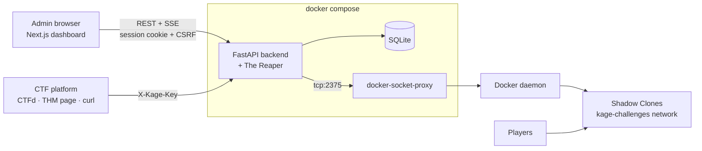

# The Kage Protocol

[](https://github.com/Sl4cK0TH/kage-protocol/actions/workflows/ci.yml)

A self-hosted control plane for **on-demand CTF challenge containers**. Admins define Docker-based challenges, players (or your CTF platform) spawn isolated instances through a small API, and a background reaper tears them down when their time is up — all watched from a live, cyberpunk-styled command center.

**Platform-agnostic:** works with CTFd, a TryHackMe room, a workshop `curl` command, or any platform that can make an HTTP request.

## Terminology

| In the UI | Means |
|---|---|
| **Jutsu** | A challenge definition: Docker image, internal ports, RAM/CPU limits |
| **Shadow Clone** | A running container spawned from a Jutsu |
| **The Reaper** | Background task that removes clones whose TTL has expired |
| **Chakra Control** | Global settings: default TTL and the host-port range |

## Features

- **Jutsu Library** — create, edit, and delete challenges; spawn a clone for testing; **pull an image** with live per-layer progress.
- **Active Clones** — a live table of every clone with its Jutsu, ports, and countdown. Click one to open a detail drawer with **live-tailing logs**, live CPU/memory, copyable connection addresses, **extend TTL** (+15/+30/+60 min), and kill.
- **Live dashboard** — updates are pushed over Server-Sent Events (with automatic fallback to polling), with trend sparklines and an activity feed of spawns, kills, extensions, reaps, and admin actions.
- **Audit Log** — every admin, platform, and Reaper action, with pagination, an action filter, whole-log summary counts, and automatic retention.
- **Public API** — API-key-protected spawn/stop endpoints for CTF platforms, rate-limited per key and client IP.
- **The Reaper** — checks every 60 seconds and honors TTL extensions.
- Responsive layout with a collapsible sidebar for smaller screens.

## Architecture



- **Frontend:** Next.js 14 (App Router), React 18, Tailwind CSS, TypeScript
- **Backend:** FastAPI (Python 3.11), SQLModel on SQLite
- **Infrastructure:** Docker SDK, reached only through a [Tecnativa docker-socket-proxy](https://github.com/Tecnativa/docker-socket-proxy) — the backend never mounts the raw Docker socket

## Repository Layout

```text
backend/
  app/            FastAPI app: routes/, services/, core/ (config, auth, CSRF, rate limit), reaper.py
  tests/          pytest suite (runs against an in-memory fake Docker daemon)
  scripts/        hash_password.py, spawn_test.sh
  INTEGRATION.md  Public API and platform integration guide
frontend/         Next.js admin dashboard (see frontend/README.md)
docker-compose.yml  Backend, frontend, and Docker socket proxy
.github/workflows/  CI
run.sh              Interactive setup and launcher
```

## Prerequisites

- Docker and Docker Compose
- Node.js **18.17+** — only for running the frontend outside Docker
- Python **3.11** for local backend development and tests — the pinned dependencies don't build on Python 3.13+

## Quick Start

```bash
./run.sh
```

On first run it asks for everything it needs, then builds and starts the backend, dashboard, and Docker socket proxy:

- **Admin account**: username and password. The password is typed hidden, confirmed, and bcrypt-hashed inside the backend's Docker image, so no local Python is needed.
- **Network**: the host you'll open the dashboard from, the host players connect to, and the ports (defaults: API **8081**, dashboard **8082**). Ports already used by other programs are rejected.
- **Secrets**: a platform API key and session secret are generated for you. The API key is printed once, for your CTF platform's config.

When both services respond, it prints the dashboard URL. Log in with the account you just created.

| Command | What it does |
|---|---|
| `./run.sh` | Start (runs setup first if Kage isn't configured yet) |
| `./run.sh setup` | Change settings: current values are the defaults, a blank password keeps the existing one, and `backend/.env` is backed up first |
| `./run.sh stop` | Stop everything (data is kept) |
| `./run.sh status` | Show container status |
| `./run.sh logs [service]` | Follow logs |

Then add a Jutsu (pull its image first if it isn't on the host), spawn a clone, and point your platform at the public API — see [backend/INTEGRATION.md](backend/INTEGRATION.md).

<details>
<summary><b>Manual setup (without run.sh)</b></summary>

1. Generate the password hash: `pip install bcrypt && python backend/scripts/hash_password.py 'your_password'`
2. `cp backend/.env.example backend/.env`, then set `ADMIN_USERNAME`, `KAGE_API_KEY`, `SESSION_SECRET` (long random strings for the last two), and paste the `ADMIN_PASSWORD_HASH=...` line from step 1.
3. Pin the project name so every command manages the same stack: `echo "COMPOSE_PROJECT_NAME=kage" > .env`
4. `docker compose up -d --build`, then open `http://localhost:8082`.

> [!IMPORTANT]
> Keep the **single quotes** around the hash: `ADMIN_PASSWORD_HASH='$2b$12$...'`.
> Docker Compose interpolates `$VAR` in env files, so an unquoted hash is silently truncated and login always fails.

</details>

> [!NOTE]
> The dashboard's backend URL is baked in **when the image is built**. If you change ports or hosts by hand rather than with `./run.sh setup`, update `KAGE_PUBLIC_API_URL` and `CORS_ORIGINS` to match, then rebuild with `docker compose up -d --build`.

For frontend development with hot reload, run it outside Docker instead — see [frontend/README.md](frontend/README.md).

## Using the Dashboard

| Page | What you can do |
|---|---|
| **Dashboard** | Live clone/CPU/memory telemetry with sparklines and the recent-activity feed. The **Live / Polling** badge shows whether the SSE stream is connected. |
| **Jutsu Library** | Manage challenges. **Pull** downloads the Jutsu's image with streaming progress; **Spawn** starts a clone using the default TTL. |
| **Active Clones** | Click a row for the detail drawer: live logs, per-clone CPU/memory, port mappings with copy buttons, TTL extension, and kill. |
| **Audit Log** | Browse all events 50 at a time, filter by action, and see counts across the whole log. |
| **Settings** | Default TTL (1–1440 minutes) and the host-port range clones are published on (1024–65535). |
| **Documentation** | In-app API reference and copy-ready integration snippets. |

## Configuration

### Backend (`backend/.env`)

| Variable | Required | Default | Description |
|---|---|---|---|
| `ADMIN_USERNAME` | ✅ | | Admin login username |
| `ADMIN_PASSWORD_HASH` | ✅ | | bcrypt hash of the admin password (single-quoted — see Quick Start) |
| `KAGE_API_KEY` | ✅ | | Key platforms send as `X-Kage-Key` on the public API |
| `SESSION_SECRET` | ✅ | | Secret used to sign session cookies |
| `SESSION_COOKIE_NAME` | | `kage_session` | Session cookie name (keep in sync with the frontend) |
| `SESSION_MAX_AGE_SECONDS` | | `3600` | Admin session lifetime |
| `COOKIE_SECURE` | | `false` | Set `true` when served over HTTPS |
| `CORS_ORIGINS` | | `http://localhost:3000` | Comma-separated origins allowed to call the API — include the dashboard's origin, e.g. `http://localhost:8082` for Docker and `http://localhost:3000` for `npm run dev` |
| `DB_URL` | | `sqlite:///./data/kage.db` | Database URL |
| `PUBLIC_HOST` | | `localhost` | Hostname returned to players in spawn responses |
| `CHALLENGE_NETWORK` | | `kage-challenges` | Docker network clones are attached to (created on startup) |
| `SPAWN_RATE_LIMIT_COUNT` | | `30` | Max spawn (and, separately, stop) requests per window, per API key + client IP |
| `SPAWN_RATE_LIMIT_WINDOW_SECONDS` | | `60` | Rate-limit window |
| `AUDIT_RETENTION_DAYS` | | `90` | Delete audit entries older than this (checked hourly); `0` keeps them forever |
| `LOG_LEVEL` | | `INFO` | Python log level |
| `JSON_LOGS` | | `false` | Emit JSON-formatted logs |
| `DEFAULT_CPU_LIMIT` | | `0.5` | Currently unused — each Jutsu's own CPU limit applies (default 0.5 cores) |

### Docker Compose (shell environment or a repo-root `.env`)

| Variable | Default | Description |
|---|---|---|
| `KAGE_BACKEND_PORT` | `8081` | Host port the backend API is published on. |
| `KAGE_PUBLIC_API_URL` | `http://localhost:8081` | Backend URL baked into the dashboard image — the address the admin's *browser* uses. Rebuild after changing. |
| `KAGE_FRONTEND_PORT` | `8082` | Host port the dashboard is published on. Add the matching origin to `CORS_ORIGINS`. |

`./run.sh setup` writes these to the repo-root `.env` for you, together with `COMPOSE_PROJECT_NAME=kage`.

### Frontend outside Docker (`frontend/.env`)

| Variable | Default | Description |
|---|---|---|
| `NEXT_PUBLIC_API_BASE` | `http://localhost:8081` | Backend URL, as reachable from the admin's browser |
| `NEXT_PUBLIC_SESSION_COOKIE_NAME` | `kage_session` | Must match the backend's `SESSION_COOKIE_NAME` |

## API Overview

- **Public API** (`X-Kage-Key`): `POST /api/spawn/{challenge_id}` and `DELETE /api/spawn/{container_id}` — documented in full in [backend/INTEGRATION.md](backend/INTEGRATION.md).
- **Admin API** (`/api/admin/*`): used by the dashboard; requires the HTTP-only session cookie, plus the `X-CSRF-Token` header on state-changing requests. Live data is served as Server-Sent Events from `/api/admin/stream`, `/api/admin/docker/containers/{id}/logs/stream`, and `/api/admin/docker/images/pull/stream`.
- **Health:** `GET /api/health` (unauthenticated) reports Docker and database connectivity.
- Interactive OpenAPI docs are served by FastAPI at `/docs`.

## Security

- **Docker socket proxy** — the backend talks to Docker only through a proxy that denies exec, volumes, builds, swarm, secrets, and other unneeded APIs.
- **Scoped container operations** — logs, stop, and TTL changes only work on containers Kage spawned (identified by label). Any other container ID or name returns 404, even with a valid key or admin session.
- **Admin auth** — bcrypt-hashed password, signed HTTP-only `SameSite=Lax` session cookie, and double-submit CSRF protection on every state-changing admin request.
- **Container isolation** — clones run on a dedicated network with per-Jutsu RAM and CPU limits.
- **Rate limiting** — public spawn and stop requests are limited per API key + client IP.
- **Audit logging** — admin, platform, and Reaper actions are recorded with timestamps and client IPs.

> [!WARNING]
> The API key is a **single shared secret**. Anything that embeds it client-side (for example the TryHackMe landing-page snippet) exposes it to players, who can then spawn and stop clones directly. Keep the key server-side wherever possible — see [backend/INTEGRATION.md](backend/INTEGRATION.md#security-notes).

## Deployment Notes

- **Serve the dashboard and API from the same site** (e.g. `kage.example.com` and `api.kage.example.com`). The session cookie is `SameSite=Lax`, so a dashboard on an unrelated domain won't send it.
- **HTTPS:** set `COOKIE_SECURE=true` and put both services behind TLS.
- **Reverse proxies and SSE:** the stream endpoints send `X-Accel-Buffering: no`, which nginx honors. If the dashboard badge shows **Polling** instead of **Live**, a proxy or CDN is buffering responses — disable buffering for `/api/admin/*stream*`.
- **Client IPs behind a proxy:** uvicorn only trusts `X-Forwarded-For` from `127.0.0.1` by default. Behind a separate proxy container, every request appears to come from the proxy — so rate limiting and audit IPs collapse to one address — unless uvicorn is started with `--forwarded-allow-ips` set to the proxy's address.
- **Server-side platform integrations** (such as CTFd) send every spawn from one IP, so the rate limit applies to the platform as a whole. Raise `SPAWN_RATE_LIMIT_COUNT` to fit your expected burst of simultaneous starts.
- **Schema changes:** tables are created automatically on startup, but existing tables aren't migrated. New tables appear on their own; changes to existing columns need a manual migration.

## Commands

Backend (from `backend/`):

- `./run.sh` — set up (first run) and start everything; see [Quick Start](#quick-start)
- `docker compose up -d --build` — start the backend, dashboard, and socket proxy without the script
- `docker compose down` — stop the stack
- `uvicorn app.main:app --reload` — run the backend locally (needs a reachable Docker daemon)
- `pip install -r requirements-dev.txt && pytest` — run the test suite (Python 3.11)

Frontend (from `frontend/`):

- `npm run dev` — development server
- `npm run build` / `npm run start` — production build and server
- `npx tsc --noEmit` — type-check (what CI runs)

## Testing & CI

The backend suite (`backend/tests/`) runs the real `DockerService` logic against an in-memory fake Docker daemon, so it needs no Docker access and runs in a couple of seconds. It covers auth and CSRF, Jutsu and settings validation, spawn/stop/extend flows (including container-ownership checks), the Reaper, audit pagination and retention, and the SSE streams.

GitHub Actions (`.github/workflows/ci.yml`) runs on every push to `master` and on pull requests: backend tests on Python 3.11, a frontend type-check and production build, and a backend Docker image build.

## Known Limitations

- One shared API key for all platforms. Per-platform keys that can be rotated and revoked are planned.
- Next.js 14.2.35 still has advisories that are only fixed in Next 15/16; an upgrade is planned.
- The rate limiter is in memory, so limits reset on restart and aren't shared across multiple backend instances.
- The dashboard's sparkline history lives in the browser and resets on reload.

## License

Add your license terms here.
